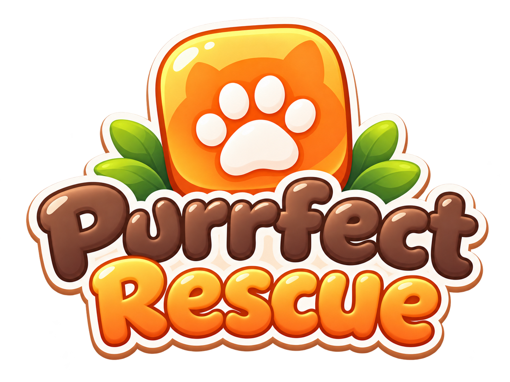

# Purrfect Rescue — Спасение котиков

<p align="center"></p>

Уютная пошаговая головоломка о гуманном спасении уличных кошек. Вы расставляете котоловушки, корм, укрытия и игрушки, а кошки сами решают, что делать, по понятным детерминированным правилам. Спасённые котики переезжают в приют «Тёплый дом».

- 29 уровней в трёх главах: «Первые шаги», «Новые соседи» и «Мастер спасения». Каждый уровень учит новой механике или неожиданно сочетает уже знакомые, сложность растёт к финалу.
- Приют растёт вместе с вами: гостиная, детская для котят, веранда, чердак и кухня открываются по мере спасения.
- Изометрическое игровое поле нарисовано процедурно (SVG и векторная графика Phaser). Главный экран, Саша и котики на нём — иллюстрированные спрайты.
- **Саша**, волонтёр приюта, встречает перед каждым уровнем: короткий брифинг в стиле визуальной новеллы, подсветка нужного инструмента или кошки. Подсказки и реплика на экране победы тоже от её лица.
- Синтезированные звуки и фоновая мелодия на WebAudio, без аудиофайлов.
- Работает на компьютере и телефоне: мышь, касания, pinch-zoom.
- Прогресс, звёзды, приют и настройки хранятся в `localStorage`.

## Запуск

```bash
npm install
npm run dev        # http://localhost:5173
```

| Команда | Что делает |
| --- | --- |
| `npm run dev` | Dev-сервер Vite |
| `npm run build` | Production-сборка в `dist/` (статические файлы, можно открыть с любого хостинга) |
| `npm run preview` | Локально раздать собранную версию |
| `npm test` | Все автотесты (Vitest) |
| `npm run check` | Проверка типов TypeScript и Svelte |

Требуется Node.js 20+.

### Управление

- **Инструмент** на нижней панели → **клетка** на поле. Каждое подтверждённое действие тратит 1 ход. Выбор, отмена и наведение ход не тратят.
- **Ловушка** ставится в два касания: клетка с приманкой, затем сторона входа (стрелки).
- **Повернуть**: ловушка → клетка со стрелкой, куда должен смотреть вход.
- Нажатие на кошку или объект без инструмента открывает карточку с характеристиками, состоянием и контекстными действиями (например, «Открыть калитку · 1 ход»).
- Клавиши: `Пробел` — ждать, `Z` — отменить ход, `Shift+R` — заново, `Esc` — снять выбор / пауза, `1–7` — инструменты, `+`/`-` — зум.

## Уровни

**Глава 1 · Первые шаги**

1. «Рыжик» — первое знакомство (Рыжик)
2. «Неправильная сторона» — ловушка смотрит не туда (Персик)
3. «Пугливый Дартик» — только по тени (Дартик)
4. «Два голодных кота» — кто первый — того и миска (Бублик, Мята)
5. «Шумный двор» — сосед заводит газонокосилку (Тишка)
6. «Закрытая калитка» — калитка на пружине (Ириска)
7. «Любопытная Плюшка» — еда подождёт, а вот перо… (Плюшка)
8. «Шаня» — три лапы, свой характер (Шаня)
9. «Большое спасение» — весь двор в сборе (Барон, Луна, Кнопка)

**Глава 2 · Новые соседи**

10. «Мама Мурка» — где мама — там и малыш (Мурка, Пушок)
11. «Колокольчик» — дзынь — и в кусты! (Зефирка)
12. «Привереда» — только тунец, пожалуйста (Маркиз, Котлета)
13. «Гаражные ворота» — задирам вход воспрещён (Бандит, Тучка)
14. «Миска соседки» — кому достанется угощение? (Ася, Кабачок)
15. «Профессор» — не торопите старика (Профессор)
16. «Тихий пруд» — ни шагу на солнце (Чернушка)
17. «Тройняшки» — каждому — свою ловушку (Кекс, Пряник, Ватрушка)
18. «Котята-непоседы» — кто первый — того и тунец (Дымка, Фантик, Бусинка)
19. «Гроза гаражей» — кто тут главный? (Атаман, Шпрота, Митя)

**Глава 3 · Мастер спасения**

20. «Граф Сметанкин» — подачек не принимаем (Граф, Тефтелька)
21. «Две калитки» — всему своё время (Лиска, Сажик)
22. «Радио на рынке» — хит, который всех разгоняет (Изюм, Корица)
23. «Ленивец Пельмень» — не спеши, но поторопись (Пельмень, Шустрик)
24. «Котята на гаражах» — мама впереди, малыши — хвостиком (Багира, Уголёк, Искорка)
25. «Ящичный лабиринт» — тень, ящики и одна обжора (Тимоша, Нюша)
26. «Музыка ветра» — динь-дон — и все по кустам (Ромашка, Кузя)
27. «Большая семья» — завтрак на четверых (Маруся, Сырник, Блинчик, Оладушек)
28. «Ярмарка» — четыре характера и ни одной лишней миски (Мармелад, Лорд, Ворчун, Пушинка)
29. «Последний двор» — тот самый двор, с которого всё началось (Генерал, Снежок, Вишенка, Лаки)

## Публикация на GitHub Pages

Сборка и деплой настроены в `.github/workflows/deploy.yml`:

- каждый пуш в `main`: проверка типов, тесты, сборка и публикация на GitHub Pages;
- пулл-реквесты: те же проверки, но без публикации;
- кнопка **Run workflow** во вкладке Actions: ручной передеплой.

Один раз нужно включить Pages: **Settings → Pages → Build and deployment → Source: GitHub Actions**. После первого успешного прогона игра будет доступна по адресу `https://<пользователь>.github.io/<репозиторий>/`. В `vite.config.ts` стоит `base: './'`, поэтому сборка работает из любой подпапки и переименование репозитория ничего не ломает.

## Архитектура

```
src/
  core/            чистая логика, без Phaser и DOM
    types.ts         модель данных: GameState, Cat, Trap, Action, GameEvent
    grid.ts          координаты, направления, сравнения
    world.ts         запросы к миру: проходимость, тень (укрытость), шумовые зоны
    pathfinding.ts   детерминированный Dijkstra с поклеточной стоимостью
    catAI.ts         CatAI: восприятие и выбор цели (utility)
    movement.ts      одновременное движение и разрешение конфликтов
    trapSystem.ts    TrapSystem: установка, поворот, поимка
    itemSystem.ts    ItemSystem: корм, укрытия, игрушки, поедание, порча
    environment.ts   EnvironmentSystem: калитки, шумные механизмы, расписания
    turnSystem.ts    TurnSystem: один ход целиком (чистая функция)
    gameCore.ts      GameCore: сессия уровня, история (Undo), Replay, превью, тупики
    level.ts         LevelSystem: формат JSON, валидация, начальное состояние
    scoring.ts       звёзды
    rules.ts         все числовые константы баланса
    solver.ts        BFS-решатель для тестов и дизайна уровней
    debug.ts         ASCII-рендер состояния
  levels/          l1.json … l8.json и реестр
  render/          GameRenderer на Phaser
    BoardScene.ts    сцена: рисует снимки состояния и анимирует события
    BoardView.ts     обёртка над Phaser.Game для UI (DPR, resize, API)
    drawIso.ts       процедурная изометрия: стены, заборы, калитки, ловушки, коробки
    iso.ts           проекция grid ↔ screen, порядок отрисовки по глубине
    textures.ts      растеризация SVG в текстуры
  art/             SVG-генераторы: кошки (11 поз × 5 окрасов), пропсы, иконки; sprites.ts — иллюстрации
  assets/sprites/  нарезанные WebP-спрайты (фон меню, Саша, котики, домик, облака…)
  audio/           синтезатор эффектов и музыки (поддерживает замену на файлы)
  persistence/     сохранения в localStorage с валидацией
  app/             глобальное состояние (Svelte runes), игровая сессия, тексты
  ui/              Svelte-экраны: меню, уровни, HUD, приют, настройки
```

Ключевой принцип: **симуляция не знает о Phaser**. `runTurn(state, action)` возвращает новое состояние и список событий (`catMove`, `catTrapped`, `emote` и т. д.). Рендерер получает `(prev, next, events)` и анимирует разницу. Если игрок жмёт быстрее анимации, рендерер мгновенно завершает текущие твины и синхронизируется с последним состоянием, поэтому ввод никогда не блокируется.

`GameSession` (`src/app/session.svelte.ts`) переводит касания в действия. Для каждого наведения он строит превью: применяет гипотетическое действие к копии состояния и показывает, куда теперь пойдут кошки. Поэтому маршруты на поле честные: это ровно то, что посчитает симуляция.

## Как устроен один ход

`src/core/turnSystem.ts`:

1. **Действие игрока** проверяется: если оно недопустимо, игрок получает причину, а ход не тратится. Затем действие применяется.
2. **Окружение**: включаются и выключаются шумы по расписанию.
3. **Восприятие и решения**: все кошки решают по **одному снимку мира**, поэтому порядок кошек в массиве не влияет на результат.
4. **Конфликты движения**: две кошки хотят в одну клетку — выигрывает испуганная, потом та, у которой короче оставшийся путь, потом по id. Встречный обмен клетками запрещён, в ловушке может быть только одна кошка.
5. **Перемещение** на одну клетку.
6. **Взаимодействия**: поимка (кошка встала на дальнюю половину ловушки), поедание корма (голод −1, доверие +1), укрытие, игра.
7. **Таймеры**: порча корма (8 ходов), игрушки (5 ходов), время в укрытии, пружина калитки.
8. **Победа**: все кошки в ловушках.
9. **События** уходят в рендерер и звук.

Нет ни одного вызова `Math.random`. Одинаковая последовательность действий всегда даёт одинаковый результат; это проверяет тест.

## Поведение кошек

Приоритеты (`src/core/catAI.ts`):

1. **Угроза.** Шум в радиусе (для пугливости ≥ 1) → состояние «испугана» (`!`): кошка бежит к ближайшему безопасному укрытию (куст, будка, коробка), обходя шумную зону.
2. **Укрытие.** В укрытии кошка сидит `пугливость + 1` ход, потом успокаивается.
3. **Интерес.** Лучшая цель по полезности:
   - корм виден в радиусе `голод + 1` (тунец +2), при голоде 0 корм не интересен;
   - полезность = `20 + 10·голод + любимая еда (8) + тунец (4) − недоверие к ловушке − стоимость пути/5`;
   - игрушка видна в радиусе `любопытство + 2`, её полезность = `22 + 10·любопытство − путь/5`;
   - замеченную цель кошка преследует до конца, так что дрожания на границе радиуса нет.
4. **Привычка.** Обход маршрута (`patrol`) или возвращение на любимое место; без дела кошка сидит, умывается или спит, если сыта.

**Тень и страх.** Клетка «в тени», если на ней или рядом стоит забор, стена, дерево, куст, будка, калитка или коробка. Тень видна на поле. Цена шага: 10. Открытая клетка добавляет 0 / 3 / 12 / ∞ в зависимости от пугливости, поэтому кошка с пугливостью 3 вообще не выходит на солнце. Шумная зона добавляет 40.

**Соседи.** Клетка, где стоит другая кошка, дороже на 25, поэтому кошки обходят спящего соседа. У входа в ловушку кошки ждут очереди и не загораживают дверцу, пока внутри кто-то есть. Обычные прогулки, возвращение домой и бегство никогда не ведут внутрь ловушки: туда заходят только за приманкой.

**Осторожность.** Если пугливость больше доверия, кошка у входа в ловушку медлит (`?`), и каждая заминка прибавляет доверие. Корм на земле тоже повышает доверие, но снижает голод, а значит, и радиус чутья: перекормленная кошка теряет интерес.

### Как задать характер кошки

В JSON уровня:

```json
{
  "id": "dartik",
  "name": "Дартик",
  "pos": [1, 6],
  "traits": { "hunger": 3, "fear": 3, "curiosity": 0, "trust": 1 },
  "preferredFood": "tuna",
  "patrol": [[1, 6], [1, 1]],
  "home": [1, 6],
  "look": { "pattern": "solid", "base": "#3F4150", "accent": "#5C5F72", "stripe": "#2C2D38", "eyes": "#F0C94A" },
  "personality": "Повелитель тени",
  "bio": "История для карточки в приюте"
}
```

- `traits`: целые числа 0–3.
- `pace` (необязательно, 1–3): кошка делает шаг раз в столько ходов, а в промежутке переводит дух. Так ходит трёхлапый Шаня (`pace: 2`).
- `minNotice` (необязательно, 0–4): самостоятельная кошка не замечает новую еду ближе этого расстояния. Подачку под нос она игнорирует, а найти сама может только издалека. Уже замеченную цель продолжает преследовать.
- `picky` (необязательно): привереда ест только `preferredFood`, на другую еду даже не смотрит.
- `follows` (необязательно): котёнок держится не дальше 2 клеток от мамы (id другой кошки), а когда мама в ловушке, приходит к ней и ждёт рядом. Еда, игрушки и шум важнее: голодный котёнок отвлечётся на угощение.
- `look.legs: 3` рисует кошку без ближней передней лапы во всех позах, `look.kitten: true` — маленького котёнка с большой головой.
- `look.pattern`: `solid` | `tabby` | `tuxedo` | `calico` | `siamese` | `bicolor` (белая с чёрными пятнами и чёрным хвостом). `accent` — грудка, мордочка или рыжие пятна, `stripe` — полоски, тёмные пятна или «маска» сиамца. Все позы генерируются автоматически.

## Иллюстрации и Саша

Исходные спрайтшиты лежат в `assets-src/` (PNG с прозрачностью). Скрипт находит каждый спрайт по связной области альфа-канала, чистит мусорные пиксели и сохраняет WebP в `src/assets/sprites/`:

```bash
python3 scripts/slice_sprites.py   # нужны Pillow, numpy, scipy
```

Брифинг Саши задаётся в JSON уровня:

```json
"intro": [
  { "pose": "wave", "text": "Привет! Я Саша…" },
  { "pose": "hold", "text": "Возьми корм…", "focus": { "tool": "kibble", "cat": "ryzhik", "cells": [[2, 3]] } }
],
"outro": "Рыжик в безопасности!"
```

- `pose`: `wave` | `hold` | `hug` | `pet`.
- `focus` подсвечивает инструмент на панели, кошку (над ней прыгает стрелка) или клетки.
- Брифинг показывается автоматически при первом входе на уровень, если включены подсказки. Повторить его можно кнопкой с лицом Саши в верхней панели.

## Как создать уровень

1. Создайте `src/levels/l9.json` (поля — `LevelDef` в `src/core/level.ts`).
2. Нарисуйте карту строками, по одному символу на клетку:

| Символ | Клетка | Символ | Клетка |
| --- | --- | --- | --- |
| `.` | трава | `#` | кирпичная стена |
| `,` | дорожка | `F` | забор |
| `:` | земля | `T` | дерево |
| `*` | цветы | `R` | камень |
| `B` | куст (проходим, укрытие) | `C` | ящики |
| `D` | будка (проходима, укрытие) | `S` | сарай |
| `G` | калитка (нужно описание в `gates`) | `~` | пруд |

3. Добавьте `intro` и `outro` для Саши (см. выше), `cats`, `traps` (`pos` — клетка с приманкой, `dir` — куда смотрит вход, `rotatable`), `gates` (`autoClose` — пружина), `noises` (`schedule: {start, duration, every}` или `interactive`), `foods` (миска соседки, лежит с самого начала), `inventory`, `stars`, `hints` (`start`, `turn:N`, `tool:kibble`, `placed:toy`, `gateClosed`).
4. Впишите **эталонное решение** в `solution`. Тест прогонит его и проверит победу на три звезды.
5. Файл подхватится сам (`import.meta.glob` в `src/levels/index.ts`). Главы задаются там же, в `CHAPTERS`.

Инструменты для дизайна:

```bash
# проверки: валидность, эталон и его звёзды, «ничего не делать», «просто положить корм в ловушку»
LEVEL=l9 npx vitest run scripts/design.test.ts --config scripts/vitest.config.ts --reporter=verbose
# + пошаговый ASCII-прогон эталона (TRACE=1), точный оптимум перебором (SOLVE=1 MAXT=12 [MAXI=2])
# или быстрая верхняя оценка для больших уровней (ROLL=1 MAXD=4 MAXT=30)
TRACE=1 SOLVE=1 MAXT=12 LEVEL=l9 npx vitest run scripts/design.test.ts --config scripts/vitest.config.ts --reporter=verbose
# проверить произвольную последовательность (V=1 печатает каждый ход)
LEVEL=l9 STEPS='[{"type":"placeFood","kind":"kibble","cell":[2,3]},{"type":"wait","times":5}]' \
  npx vitest run scripts/try.test.ts --config scripts/vitest.config.ts --reporter=verbose
```

## Как добавить новый инструмент

1. `src/core/types.ts`: добавьте `ItemKind` и вариант `Action`, а при необходимости — сущность в `GameState`.
2. `src/core/itemSystem.ts`: напишите `validateX` (возвращает причину отказа на русском) и `applyX` (тратит инвентарь, пишет `used`, создаёт событие `placed`).
3. `src/core/turnSystem.ts`: добавьте ветки в `validateAction` и `applyAction`. Если инструмент влияет на кошек, научите этому `catAI.ts` (кандидат цели или стоимость пути) или `world.ts` (тень, проходимость).
4. `src/app/session.svelte.ts`: добавьте `Tool`, `actionFor` и подсветку допустимых клеток в `buildOverlay`.
5. Нарисуйте SVG в `src/art/props.ts` и иконку в `src/art/toolIcons.ts`, вид — в `BoardScene` (`make…` и `syncTo`).
6. Добавьте тест в `tests/`.

Новые интерактивные объекты (двери, контейнеры, движущиеся препятствия) подключаются через `environment.ts`: `validateInteract`, `applyInteract`, `updateEnvironment`, `tickEnvironment`.

## Тесты

```bash
npm test
```

| Файл | Что проверяется |
| --- | --- |
| `pathfinding.test.ts` | кратчайший путь, обход препятствий, детерминированность, страх и тень, стены ловушки |
| `catAI.test.ts` | выбор цели, любимая еда, голод 0, радиус чутья, игрушка важнее еды, патруль, испуг, укрытие, осторожность у входа, медленный шаг, «не берёт подачки», привереды, котята рядом с мамой и не загораживают ей дорогу |
| `traps.test.ts` | поимка через вход, обход сбоку, касание сбоку не ловит, занятая ловушка, установка, поворот |
| `turn.test.ts` | детерминированность, независимость от порядка кошек, чистота `runTurn`, отказ без траты хода, расход ресурсов, порча корма, доверие, конфликты клеток, запрет обмена, калитка на пружине |
| `gameCore.test.ts` | Undo, Restart, превью без мутаций, Replay, звёзды, обнаружение тупика |
| `persistence.test.ts` | сохранение и загрузка, лучший результат, мусор в storage, падение storage, разблокировка уровней |
| `levels.test.ts` | валидность и проходимость всех 29 уровней на 3 звезды, у каждого есть брифинг Саши; ничегонеделание и «просто положить корм в ловушку» не работают; неправильный порядок в уровнях 4, 6 и 8 ведёт в тупик |
| `solver.test.ts` | решатель находит оптимальные решения уровней 1, 2, 6 и подтверждает пороги звёзд |
| `art.test.ts` | все SVG корректны (иначе текстура не загрузится) |
| `fuzz.test.ts` | по 25 случайных партий на каждом уровне: кошки не стоят в одной клетке и в стенах, пойманные лежат на тарелке ловушки, инвентарь не уходит в минус |
| `regressions.test.ts` | исправленные ошибки: кошка на маршруте не заходит в ловушку без приманки, затор в дверце ловушки, корм под лапами, обход спящей кошки, ловушка поверх входа другой ловушки, открытая калитка на пружине |

## Известные ограничения

- Встроенный решатель полным перебором подтверждает оптимум только для небольших уровней. Пороги трёх звёзд уровней 10–29 при разработке проверялись отдельными точными переборами по расстановкам и таймингам (или доказывались нижней оценкой). Если игрок найдёт путь короче, он тоже получит три звезды.
- Кошки ходят на одну клетку за ход. Испуганная кошка не бежит быстрее, так проще считать.
- Уровень 10×10 на узком телефоне выглядит мелко: помогают pinch-zoom и кнопки зума.
- Звуки синтезированы. Настоящие сэмплы подключаются через `audio.registerSample(name, url)`; если файла нет, остаётся синтез.
- Интерфейс только на русском.
